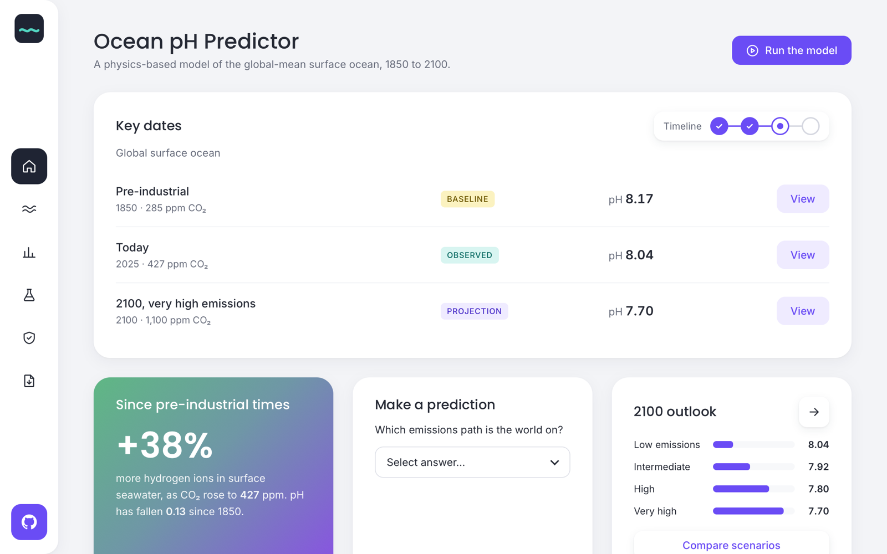

# Sour Seas: ocean pH predictor site

**Live site:** https://itzstephen167.github.io/ocean-acidification-predictor/



Static site, no build step.

```bash
python3 -m http.server 8765
# open http://localhost:8765
```

Deploy by uploading this folder to any static host (Netlify, GitHub Pages, Vercel, S3).

| File | Role |
|---|---|
| `index.html`, `home.js` | Overview page: key dates, model limits, downloads |
| `explore.html`, `explore.js` | Explorer page: tank, charts, dials |
| `scenarios.html`, `scenarios.js` | Scenarios page: overlay any two emissions paths |
| `chemistry.html`, `chemistry.js` | Chemistry page: pump in CO₂ and watch the carbonate system shift |
| `common.js`, `styles.css` | Shared rail, scenario names and styling |
| `assets/model.js` | JavaScript port of `ocean_ph_model.py` (matches Python to ≤0.00005 pH) |
| `assets/data.js` | `projections.json` wrapped as `window.OCEAN_DATA` (file:// friendly) |
| `assets/*.py`, `.ipynb`, `.json` | Downloadable originals |

Preset scenarios at default ocean settings use the precomputed Python bands in `projections.json`.
Custom CO2 paths or changed alkalinity/temperature are recomputed in the browser, with their own
seeded Monte-Carlo band, so those bands differ slightly from Python's.

To refresh after changing the model, re-export `projections.json`, then regenerate `data.js`:

```bash
python3 -c "import json;print('window.OCEAN_DATA='+json.dumps(json.load(open('assets/projections.json')),separators=(',',':'))+';')" > assets/data.js
```
